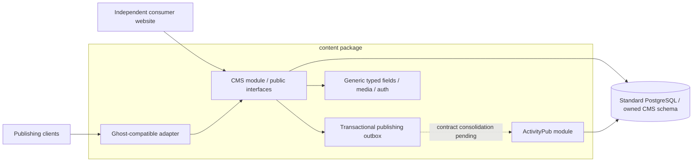

# Architecture proposal

Status: wider architecture proposed, 2026-10-25. The subsequently authorized [local create/read/edit milestone](implementation.md) is implemented and tested; the remainder below is design intent. No production service was provisioned by the CMS work. Internal Node/Fedify is now approved and has its own implementation task.

## Package and module boundary

One reusable `content` repository/package contains a Go CMS module and an ActivityPub module. The website is an independent consumer. ActivityPub uses the approved internal Node/Fedify runtime alongside the Go CMS, within one product/repository. See [ADR 0009](adr/0009-internal-fedify-runtime.md). Separate processes own separate schemas and communicate through a versioned internal API.



The Ghost adapter owns wire paths, envelopes, query parsing and errors. CMS owns content revisions, authorization and scheduling. ActivityPub owns actor/key handling, protocol projection, followers and delivery. One database does not permit arbitrary cross-module table access; communicate through a consolidated internal contract and narrow explicit grants where required. Public queries use a distinct published/public projection.

Generic package interfaces include publication commands/events, identity configuration, media storage, authentication adapters and [typed content fields](content-fields.md). Domain names, actor IDs, frontend framework, concrete page keys, importers and feed/book data belong to consumers/configuration. No personal defaults or provider SDKs enter package types.

## Conceptual ownership and current code

```text
cms/                 content, Ghost adapters, auth, rendering and generic fields
activitypub/         internal protocol/identity/delivery module; Node/Fedify
contracts/           shared publication contract and measured external profiles
storage/postgres/    configured schemas, restricted roles and migration interfaces
media/               storage interface and adapters
migrations/          separately owned/namespaced module migrations
```

These are logical ownership areas, not a promised Go import path or Node workspace. Public embedding APIs versus internal packages are finalized after third-party consumer tests. The first implemented paths are `cms/`, `storage/postgres/`, `internal/httpapi/`, `internal/config/` and `cmd/content/`. The separate ActivityPub task owns `internal/activitypub/`; its runtime results are not implied by the CMS tests. The audit-reported [publishing contract mismatch](../contracts/publication-consolidation.md) remains a blocking consolidation task.

## Go and PostgreSQL choices

Proposed starting toolchain is Go **1.27.3**, the supported patch shown by the official release history at research time. Proposed database baseline is PostgreSQL **17** on the then-current patch (**17.11**); also test on 18 before advertising it. Recheck security patches at implementation time and pin exact build images/digests. Do not require extensions or a managed-provider control API. [Go releases](https://go.dev/doc/devel/release), [PostgreSQL policy](https://www.postgresql.org/support/versioning/).

| Component | Proposed choice | Why / limits |
| --- | --- | --- |
| HTTP, JSON, templates, logging | Go `net/http`, `encoding/json`, `html/template`, `log/slog` | Small dependency surface; explicit timeouts and body limits; escape UI fields |
| PostgreSQL | `github.com/jackc/pgx/v5`, `pgxpool` | Pure Go driver; transactions, typed PostgreSQL support; explicit SQL makes compatibility projections reviewable |
| Migrations | `github.com/pressly/goose/v3`, embedded SQL | Mature ordered migrations; run as a separate explicit command with a migration lock |
| JWT | `github.com/golang-jwt/jwt/v5` | Implement HS256 validation with fixed algorithm/audience policy; library is not the authorization layer |
| Passwords | `golang.org/x/crypto/argon2` | Argon2id for native local login, tuned to the chosen server; not a Ghost password-database clone |
| HTML parsing | `golang.org/x/net/html` | Tokenized/DOM conversion instead of regular expressions |
| HTML sanitization | `github.com/microcosm-cc/bluemonday` | Explicit publishing policy and tests; sanitization differences must be disclosed |
| Markdown, only if captured client cards need it | `github.com/yuin/goldmark` family | Pure Go; inspect current module major at pinning (upstream currently documents v2); select extensions through fixtures |
| Tests | standard `testing`, `httptest`, fuzzing | Exercise actual PostgreSQL for transactional tests; no SQLite substitution |
| TLS edge / backup tooling | Caddy / PostgreSQL tools, optionally restic | OSS, self-hosted; no operational SaaS required |

The first implementation pins adopted packages in go.mod/go.sum and includes their runtime license notices. The earlier architecture did not create a module; this was superseded by the explicit local implementation approval. The actual tested toolchain is Go 1.26.4, with Go 1.26.0 as the module minimum; the earlier proposed 1.27.3 was not installed. PostgreSQL 18.6 has now passed the local integration test; PostgreSQL 17 remains untested. pgx supports PostgreSQL-specific behavior without tying us to a vendor. sqlc can be reconsidered if hand-written query scanning becomes error-prone; it is unnecessary to start. Do not add an ORM, queue service, search cluster, or object server preemptively. License evidence is in [sources](sources-and-licenses.md).

## Write transaction and publication

1. Authenticate and authorize against the requested operation and resource, then validate the Ghost DTO and conversion capability.
2. Resolve immutable content identity. Lock the post row and compare its wire `updated_at` token to prevent lost edits.
3. Store the new revision, projected body, ordered tags/authors and publication metadata in one database transaction.
4. Insert normalized outbox events with the same transaction. Nothing is delivered before commit.
5. Respond using the committed revision. Workers later deliver snapshots with stable event IDs, revision ordering and retry tracking.

Scheduling uses PostgreSQL time and due jobs persisted with the expected revision. An edit, unschedule or delete invalidates obsolete work. The worker locks and rechecks the current state before publishing; a process restart must not lose a schedule. A public read cannot expose a scheduled draft while its transition is still pending.

## Headless scope and minimal UI

Initially support draft intake, review, publishing, status changes, tag setup, token provisioning and media previews. iA Writer's browser handoff needs a reachable draft review route. Capture the actual URL first: a possible `/ghost/#/editor/post/{id}` uses a fragment the server cannot see, so a tiny client-side compatibility landing page may be necessary. It may forward to our authenticated review page; it must not claim that Ghost Admin is installed.

A public site consumes the package through explicit interfaces; no particular frontend framework or deployment is required. Theme rendering, Koenig visual editing, newsletters, members, billing, Portal and analytics remain outside the initial CMS slice. ActivityPub is an internal module using the approved internal Node/Fedify runtime.

## Provider portability and selected deployment

The core contract is standard PostgreSQL with configurable schema names, ordinary rows/files and separately protected secrets. It must work without provider SDKs, provider-auth tables, hosted functions or proprietary storage IDs. Schema identifiers are validated/quoted, never interpolated unchecked. SQL queries/migrations explicitly qualify schemas, and migration tables/locks are namespaced by installation/module/schema.

The [selected deployment profile](deployment-profiles/railway-supabase.md) uses Railway apps and ONE Supabase PostgreSQL database for CMS, ActivityPub and website-owned data. Separate schemas/roles enforce ownership while capacity, outage and full restore remain shared. Direct-connection migrations and pooler behavior require testing before deployment. A second provider-neutral consumer must run with different schemas/domains and no website dependencies before claiming third-party reuse.

## CMS format tradeoff, independent of ActivityPub runtime

Pure Go reduces operating complexity but makes Ghost's JavaScript Lexical/Koenig renderers unavailable at runtime. The first format implementation must be deliberately bounded. A captured client requiring a large unimplemented card set is a scope gate, not justification to promise a general converter or silently add Node.
