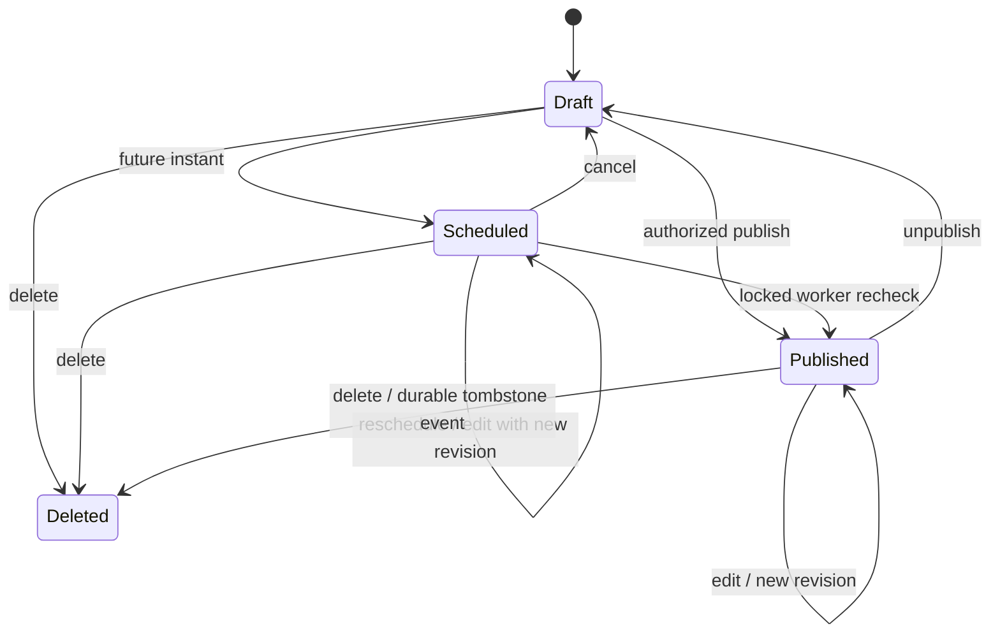

# Data model and migration strategy

This is the broader proposed logical schema. The [first implementation](implementation.md) adds installation/posts/revisions/outbox tables and a numbered SQL migration; it has only been applied to disposable local test storage. Use ordinary PostgreSQL tables, foreign keys, unique constraints, `timestamptz`, `jsonb` where the data is genuinely structured, and explicit SQL. Use configurable owned schemas within standard PostgreSQL; the selected deployment shares one database. Publication-scoped records/queries include explicit publication identity rather than assuming a database per site. Do not clone Ghost's MySQL schema.

## Tables

The logical tables below belong to the configured CMS schema. Publication-scoped records carry `publication_id`; external-ID/slug uniqueness, relation foreign keys and authorization queries include that scope. Do not reuse the former single-publication/database assumption as a global constraint. ActivityPub and consumer tables have different schema owners. This is isolation within one database, not a new SaaS tenant-administration feature.

| Table | Principal fields and constraints |
| --- | --- |
| `site_settings` | One settings record per explicit publication identity, title, description, language, IANA timezone, configured public/admin/media URLs; explicit public-field allowlist |
| `users` | Internal UUID, unique Ghost-facing 24-hex ID, normalized unique email, display name/slug/profile, password hash if native login enabled, role, status, timestamps |
| `integrations` | Internal UUID, Ghost-facing ID, name, capability profile, enabled flag, timestamps |
| `api_keys` | Public `kid`, kind (`staff_admin`, `integration_admin`, `content`), exactly one owning user/integration as applicable, encrypted HS256 secret OR hashed content key, secret version, revoked/created/last-used times |
| `sessions` | Hashed opaque session identifier, user, origin, creation/idle/absolute expiry, authentication strength and revocation metadata; never plaintext cookie values |
| `posts` | Internal immutable UUID, unique Ghost-facing ID, unique public UUID, `kind=post/page`, title, slug, status, visibility, current revision, `created_at`, monotonic wire `updated_at`, `published_at`, feature image/alt/caption, excerpt, canonical and SEO fields |
| `post_revisions` | Post FK + integer revision unique, submitted format/raw source, supported normalized document, rendered HTML/plaintext, renderer/sanitizer version, checksum, actor and timestamp, conversion diagnostics |
| `tags` | UUID, unique Ghost-facing ID, name, slug, visibility (`public/internal`), description and SEO fields; unique slug per site |
| `post_tags` | Post/tag FK, unique relation, integer position; no duplicate positions per post |
| `post_authors` | Post/user FK, unique relation, integer position; at least one author at successful save; first gives primary author |
| `media` | UUID, immutable storage key, logical public path, original filename, MIME, size, SHA-256, dimensions, state, creation principal/time |
| `post_media` | Post/revision/media references for retention; parse known image-bearing fields and retain conservative references for opaque imports |
| `scheduled_jobs` | Job ID, type, post ID, expected revision, due time, lease/attempts/status, unique generation key |
| `outbox_events` | Event UUID, schema version, site/content identity, ownership generation, revision, operation, visibility, immutable snapshot reference, created/available times |
| `outbox_deliveries` | Event + subscriber unique, lease owner/expiry, attempts, next attempt, outcome and bounded redacted diagnostics |
| `webhooks` | Ghost-facing ID, owning integration, event, URL, encrypted secret, API profile, enabled flag, last result metadata; only when webhook scope begins |
| `audit_log` | Append-only security/content action metadata: actor, action, target, revision, result, timestamp, request ID; no body, credentials or follower payloads |
| `external_identities` | Source namespace/site + resource kind + external ID unique; internal target; preserves original Ghost ID/UUID and legacy URLs |
| `publication_ownership` | Content ID, source system, monotonically increasing generation, active writer, activation time; migration fencing |
| `url_aliases` | Exact historical path/canonical URL mappings, target identity and redirect policy; explicit collision review |

ActivityPub tables belong to the internal module's configured owned schema, not speculative columns on CMS `posts`. Website-owned integration tables remain outside core. They must never infer actor identity from a mutable slug or display name.

## Identifier policy

Generate internal UUIDs in Go using `crypto/rand`; no PostgreSQL UUID extension is required. Distinguish three identities: database identity, Ghost-compatible 24-character hex API `id`, and public content UUID. A deterministic mapping table preserves imported Ghost IDs and UUIDs without forcing internal primary keys to share Ghost's implementation. A 12-byte random external identifier is a proposed compatible shape, not a claim of Mongo ObjectID ordering. Verify whether a client interprets IDs beyond opaque equality before fixing generation policy.

On future import, retain the original `uuid`, `id`, source site identifier and canonical URL. Independent source installations can reuse external values, so source namespace and publication identity belong in mapping uniqueness and access checks. Never merge publications merely because a title or slug matches. A renamed slug changes a URL alias, not content identity or federation object identity.

## Revision and collision invariant

The domain revision is a 64-bit increasing integer. The API concurrency token is the serialized `updated_at` timestamp because existing Ghost clients send it. Store a millisecond-aligned wire timestamp separately if needed; do not truncate arbitrary database microseconds on comparison. With the row locked:

1. Check the received timestamp equals the current stored wire token.
2. Calculate `new_token = max(database_now_to_milliseconds, old_token + 1 millisecond)`.
3. Write the new content revision and token together with relation updates, scheduling change, audit entry and outbox records.

An omitted `updated_at`, stale timestamp, failed render or invalid author must roll back the complete edit. An unchanged request's timestamp/no-op behavior must match the chosen fixture profile. Revisions retain raw source and rendered result so a later renderer change can be audited rather than rewriting old content in place.

## State machine

The reference rejects direct `published -> scheduled`; model that test explicitly. Deleted public content must immediately disappear from public queries. A private tombstone/outbox snapshot can remain for delivery, audit and retention. The wire behavior remains Ghost-like deletion, not a visible trash feature. Purge only after retention and downstream obligations are satisfied.

No newsletter work is implicit in `published`. Initially allow only public website visibility and reject email-only/paid/member writes. Distinguish scheduling time from first published time during republishes and imports; capture exact Ghost rules before freezing the schema's projection logic.

## Indexes and query rules

- Unique external IDs; indexed slug reads; publication index on `(status, visibility, published_at DESC, id DESC)` with `kind` if shared storage is used.
- Ordered relation indexes on `(post_id, position)` plus inverse `(tag_id, post_id)` / `(user_id, post_id)` for filtering.
- Due-work indexes on `(status, available_at)` or `(status, due_at)`; leases use PostgreSQL row locks and `SKIP LOCKED`, bounded batches and timeouts.
- NQL parser emits an AST. An allowlisted compiler maps properties/operators to parameterized SQL and explicit joins. User text never becomes a SQL identifier or raw `ORDER BY`.
- Offset pagination follows Ghost's public contract. Internal scans and migration batches may use keyset pagination. Concurrent changes can move offset-page boundaries; tests must separate stable-snapshot behavior from real-time browsing.
- Content API base predicates cannot be removed by user filters, `fields`, `include`, alternate ID routes, or default scopes. Counts and author/tag visibility must use the same public scope.

## Migrations

Use numbered, reviewed SQL migrations through goose for CMS. No ORM auto-migrate. Keep schema version/checksums in release evidence. Schema-qualify all DDL/DML and migration ledgers with validated/quoted configurable identifiers. Namespace advisory/table locks by installation/module/schema, stable across release versions and any future Go/Node runtime. Execute with dedicated migration roles/direct connections; serving roles cannot modify schema. Separate schema owners and explicit grants preserve logical ownership in the shared database, not physical failure isolation.

Order the first migrations by capability: site/users/keys; posts/revisions/taxonomy; media; schedules/outbox; optional webhook delivery. Include a clear rollback note for every migration, but prefer forward fixes over destructive down-migrations once data exists. Schema changes follow expand/backfill/validate/contract across releases. Large backfills are resumable jobs; unique constraints are validated against real data before activation. Database migrations never secretly fetch media, send webhooks or federate historical posts.

Test fresh install, upgrade from each supported prior application version, interrupted migration recovery, two concurrent migrators, backup restore and export/import identity mapping. PostgreSQL migrations and dumps must run without superuser extensions or provider-specific schemas. The subsequently authorized local tests use a disposable tmpfs PostgreSQL instance and unique test schemas; see [validation](validation.md). No live database was created or migrated.

Shared-database acceptance includes restricted-role cross-schema denial, concurrent migrations in separate namespaces, serialized migrations in one namespace, connection/resource limits and coordinated restore of CMS/ActivityPub/consumer references. Public queries and uniqueness constraints must consistently scope publication identity; a configurable schema alone is not authorization.
